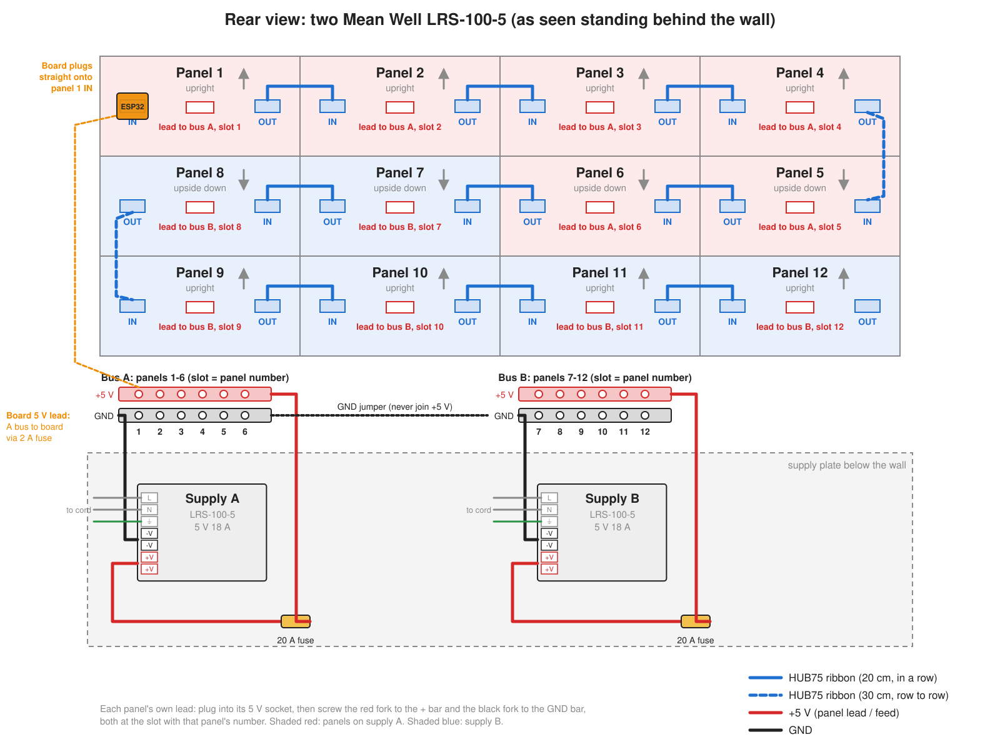
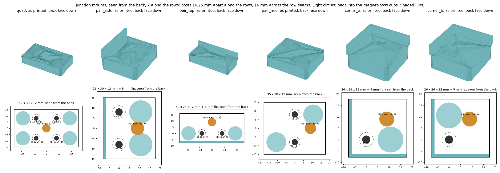

# Assembly guide: panels, wiring, controller and mounting

How the twelve P5 panels, the Waveshare controller and the supplies connect, and how to mount
it all so the supplies stay cool. The drawings are generated by
`docs/diagrams/make_diagrams.py`; current-measurement tests are in
[`power-wiring-guide.md`](power-wiring-guide.md).

> **Mains safety.** The supplies have exposed 120 V AC terminals. Wire with the cord
> unplugged, cover the AC terminals before plugging in, and connect every earth (⏚) terminal.
> If you're not comfortable with mains wiring, have an electrician do the AC side.

## 1. What connects to what

| Item | Connections |
| --- | --- |
| Each P5 panel | **IN** header (HUB75, 2 x 8 pins), **OUT** header, one 4-pin **5 V socket** (2 x +5 V, 2 x GND) |
| Each panel's included leads | one 20 cm HUB75 ribbon, one power lead (4-pin plug to red and black fork terminals) |
| Waveshare ESP32-S3-RGB-Matrix | keyed 2 x 8 **socket on its back that plugs straight onto panel 1's IN header**; USB-C data; USB-C power; two M3 **screen-power terminals** (5 V and GND); 50 x 42 mm, 2 x M2.5 holes |
| Mean Well LRS-100-5 (x2) | 1 L, 2 N, 3 ⏚, 4-5 −V, 6-7 +V; full-range input, no voltage switch |

From Waveshare's schematic: the board's HUB75 outputs go through two SN74HC245 buffers
powered from its 5 V rail, so it drives the panels at 5 V logic levels. Its data USB-C has
a reverse-current circuit on its 5 V line; its power-only USB-C and the screen-power
terminals connect straight to the 5 V rail.

## 2. Layout and chain order

Seen **from the front**, numbered by chain position (1 = the panel the controller plugs into):

```
          col 1     col 2     col 3     col 4
row 1   [  4  ] ← [  3  ] ← [  2  ] ← [  1  ]   upright        <- controller on panel 1
row 2   [  5  ] → [  6  ] → [  7  ] → [  8  ]   upside down
row 3   [ 12  ] ← [ 11  ] ← [ 10  ] ← [  9  ]   upright
```

This is the layout these panels fall into naturally, and the same one DJDevon3's build uses
("the controller will be in the top right position"; every second row upside down). It is
the HUB75 library's `CHAIN_TOP_RIGHT_DOWN`, and the firmware's panel map
(`firmware/lib/render/src/panel_map.h`) is tested pixel for pixel against that layout.

Seen **from behind** (how you'll wire it), everything is mirrored left to right: panel 1
and the controller are at the **top left**.

## 3. Telling IN from OUT, and which way is up


- The sideways arrow printed on the back points **from IN to OUT**; the up arrow shows which
  way is up.
- Seen from behind, an upright panel's IN is on the **left**; an upside-down panel's IN is on
  the **right**.
- If your panels are printed differently, follow the arrows rather than the drawings: data
  always goes OUT to the next panel's IN. The test pattern (section 7) catches mistakes.

## 4. Data and controller



1. Lay the panels face down in the layout above (so you see the backs: panel 1 at the top
   left). Rows 1 and 3 with the up arrows pointing up the wall, row 2 with them pointing down.
2. **In each row**, join each panel's OUT to the next panel's IN with the 20 cm ribbons that
   came with the panels (nine ribbons).
3. **Row to row**, join panel 4's OUT to panel 5's IN and panel 8's OUT to panel 9's IN. The
   headers are about 16 cm apart vertically, so use **30 cm ribbons** (two needed; the
   panels' 20 cm ones are too short).
4. Ribbons are keyed: the tab on the plug matches the notch in the header. Don't force one in
   the wrong way.
5. **Controller**: plug the Waveshare board straight onto panel 1's IN header (no ribbon).
   Secure it to the panel back with an M2.5 standoff or a printed clip so it doesn't hang
   on the header pins.
6. **Controller power**:
   - While testing at the bench: power it from the laptop through its **USB-C data** port and
     leave the supply lead disconnected.
   - Installed: a short red/black lead with a **2 A inline fuse** from supply A's second
     +V and −V terminals to the board's
     two M3 screen-power terminals (5 V and GND), with M3 ring terminals. Then you don't need
     USB at all; firmware updates go over Wi-Fi.
   - Don't connect the supply lead and a USB cable at the same time, and never plug a charger
     into the power-only USB-C while the supply lead is on: that port connects straight to
     the same 5 V rail.
7. The panels and the board share ground through the HUB75 header, and through the GND lead
   once it's fitted.

## 5. Power

### With the two LRS-100-5 supplies

Supply A powers panels 1 to 6 (front view: the top row and the left half of the middle row),
supply B panels 7 to 12. The firmware's power limiter assumes this split.

Two lever distribution blocks on the back of the lower seam rail distribute the power: one for +5 V, one for
GND. Each block is two isolated halves (orange and blue), so one block serves both supplies
without connecting them. Full steps in `power-wiring-guide.md` section 3.

1. Each supply's +V goes through a **20 A fuse** to its half of the **+5 V block** (supply A
   orange, supply B blue); its −V goes to its half of the **GND block**. 14 AWG wire.
2. Each panel's own lead plugs into its 5 V socket. Its red wire goes into its supply's half
   of the +5 V block and its black wire into the same half of the GND block, **at the output
   with the panel's number** (1-6 orange, 7-12 blue, as in the drawing). With two-plug
   splitter leads, one lead feeds a pair: 1+2, 3+4, 5+6, 7+8, 9+10, 11+12.
3. **Join the grounds** with a 14 AWG wire between the two supplies' second −V terminals: the
   ribbon from panel 6 to panel 7 crosses supplies, so the grounds must be common. **Never
   join the +V side.**
4. The top-row leads run about 1 m down to the blocks: extend any that don't reach in 16 or
   18 AWG, and set the supply's V.ADJ so the farthest panel reads about 5.0 V
   (`power-wiring-guide.md` test 5).
5. AC: black (hot) to L, white (neutral) to N, green to ⏚, through one switched, fused inlet
   or power strip for the whole wall.

### With one Mean Well UHP-500-5


One 8 AWG lead per output terminal (two +V, two −V) to a pair of **main bus bars** rated
100 A, then four branches of three panels: 12 AWG with a **20 A fuse** each, to small branch
bars where the panels' forks screw on. After switching, set Settings → Power supplies to
1 supply, 80 A, 85% (details in `power-wiring-guide.md` section 4).

## 6. Mounting and cooling


### The wall: 2020 frame


A flat ladder of 2020, all in one plane directly behind the panels: two end stiles, two seam
rails between them, and two short struts between the rails. Printed blocks hold it 45 mm off
the wall, and the supplies and the power blocks ride on the back of the lower rail in that
gap, so nothing shows below or beside the screen. It takes four 48 in lengths.

**Why it is built this way.** Each mount carries its share of the panels' weight at the
distance from the frame's face to the panels' centre of mass: about 20 mm with the frame
directly behind the panels, against about 50 mm if the mounts stood on 30 mm spacers. The
depth the supplies need goes between the frame and the wall instead, where the load is
mostly compression: the bottom blocks push on the wall, and the two top screws resist a pull
of only about 20 N (10 kg roughly 80 mm out from the wall, with about 420 mm between the top
and bottom blocks). Butting every joint in one plane is the joint 2020 corner brackets are
made for.

- **End stiles:** 2020, 470 mm, at each end, 10 to 30 mm in from the wall's sides and 5 mm
  in from the top and bottom, so they don't show. The frame is 1260 mm wide.
- **Seam rails:** 2020, 48 in (1220 mm), uncut, centred on the two row seams, butted between
  the end stiles.
- **Struts:** 2020, 140 mm, between the seam rails, with their left edges 415 and 845 mm from
  the wall's left edge (seen from behind). They tie the rails at a fixed spacing. **Not on
  the vertical seams:** each row's HUB75 ribbons cross the seams at mid-height, and the frame
  is only 12 mm behind the panel backs. These two spots are clear of every ribbon, header and
  power socket.
- **Corner brackets:** two at each joint, in the inside corners, bolted into the side slots
  of the two pieces they join: 8 for the rail-stile joints, 4 for the struts.
- **Junction mounts** (printed parts in [`hardware/`](../hardware/README.md)). Each panel has
  six M3 posts on its back (brass inserts): one near each corner and one at the middle of
  each long edge. Measured with a caliper, the plastic back stops about 2 mm short of the
  LED board on every side, and each post sits about 6.2 mm from its own back's edge. So with
  the LED faces butted, the posts on either side of a seam are 16.25 mm apart along the rows
  and 16.0 mm apart across the row seams. A recessed magnet boss (a round cup) sits in line
  with each post, about 10.6 mm from it along the long edge: towards the panel's middle at
  the corners, and to one side at the mid-edge posts.

  A mount screws onto the posts of the panels that meet there (M3 x 10 into counterbores,
  no washers), has short pegs on its panel side that drop into the magnet-boss cups (so it
  locates on the panels and can't twist), and carries an M5 heat-set insert for the frame
  screw. The mounts on the wall's outer edge also have a
  1.4 mm lip that runs 8 mm down the panels' outer side, in the 2 mm step between the
  plastic back and the LED board's edge: hidden under the board's overhang, the lips frame
  the array and square it up without widening the wall. There's no step between two
  panels, so lips only go on the outside.

  

  | Mount | Where | Fixed to | Number |
  | --- | --- | --- | --- |
  | quad | where four panel corners meet; its long side and pegs go along the rows | a seam rail | 6 |
  | pair_side (lip) | two corners across a row seam at the wall's left or right edge | an end stile | 4 |
  | corner_a and corner_b (lips on two sides; mirror images, so the peg points along the long edge) | seen from behind, corner_a bottom-left and top-right, corner_b top-left and bottom-right | an end stile | 2 + 2 |
  | pair_top (lip) | two corners across a seam on the top and bottom edges | nothing: joins the panels only | 6 |
  | pair_mid (no lip, optional) | the mid-edge posts across each row seam, halfway along each panel | a seam rail | 8 |

  That fixes 14 mounts (22 with the optional ones), and every panel to the frame at two or
  more corners. The top and bottom edge pairs keep those seams flush; if the long top and
  bottom edges flex more than you like, a fifth length gives top and bottom rails between
  the stiles, and those six pairs land on them. Print every mount in **PETG or ASA**, not
  PLA: they carry the wall's weight and the panel backs get warm.
- **Fixing the mounts.** Lay the panels face down with all the mounts on, lay the frame on
  them, and mark each fixed mount's insert on the frame. Drill a **6 mm hole straight
  through** the rail or stile at each mark (through the centre bore; the slightly oversized
  hole takes up about 0.5 mm of error), lay the frame back and drive an **M5 x 25 socket
  head screw with a washer** from the frame's back into each insert: 20 mm of extrusion,
  about 5 mm into the insert. Fit everything loosely, push the panels flush, then tighten.
- **Gaps.** The mount's 12 mm is the gap between the panel backs and the frame: enough for
  the two row-to-row ribbons and the power leads to pass over it. Away from the frame there
  is about 77 mm between the panel backs and the wall. Check one panel with its leads plugged in before you
  commit.
- **The controller board.** It plugs onto panel 1's IN header, 48 to 50 mm in from the
  panel's outer edge (measured), right beside the left end stile (seen from behind). A
  board 42 to 50 mm wide centred on that header comes within about 24 to 29 mm of the edge,
  so expect it to hit the stile unless its socket sits off-centre. Plug it in and measure from the panel's outer edge to the board's
  nearest edge: **32 mm or more** and it clears the stile. If it's less, mount the board on
  the frame instead, joined to panel 1's IN by a short HUB75 ribbon through a 2 x 8 male-male
  pin header (the ribbon and the board's socket are both female).
- **Wall blocks** (printed, PETG or ASA, 45 mm thick, each fixed into an end stile's rear
  slot with M5 x 30 screws and M5 T-nuts from the wall face; the counterbores are deep so
  the 30 mm screw reaches):
  - a **hanger** at the top of each end stile, with a keyhole on its wall face: the frame
    hangs on two pan-head screws (#8 or #10, head 9.5 mm or less) in the wall, left standing
    out about 3 mm. Set them 1240 mm apart (the stiles' centres) and level; the frame drops
    18 mm onto them. Into studs where you can, or anchors rated well above 10 kg;
  - a **bumper** at the bottom of each end stile, resting on the wall.

  
- **Power on the lower rail's back**, between the mount screws, as in
  [the mounting drawing](diagrams/mounting.svg): supply A 180 to 309 mm from the wall's left
  edge (seen from behind), the two blocks 656 to 784 mm, supply B 980 to 1109 mm. Panel leads
  run from each panel's socket back into the gap and along to the blocks: all under about
  0.7 m.

| Cut list (4 x 48 in 2020) | Quantity | Length |
| --- | --- | --- |
| Seam rail | 2 | 1220 mm (uncut) |
| End stile | 2 | 470 mm (both from one length) |
| Strut | 2 | 140 mm (from the fourth length; with careful cuts, from the third length's offcut instead, with 465 mm stiles) |

| Hardware | Quantity |
| --- | --- |
| Junction mounts (`hardware/stl`), PETG or ASA | 20: 6 quad, 4 pair_side, 6 pair_top, 2 corner_a, 2 corner_b (plus 8 pair_mid for the optional mid-edge mounts) |
| M5 heat-set inserts, one per fixed mount | 14 (22) |
| Wall blocks (`hardware/stl`), PETG or ASA | 2 hangers, 2 bumpers |
| M3 x 10 socket head screws into the panels' posts (no washers: the mounts are counterbored) | 48 (64) |
| M5 x 25 socket head screws and washers (frame into each fixed mount's insert) | 14 (22) |
| M5 x 30 socket head screws and M5 drop-in T-nuts (wall blocks into the end stiles) | 6 |
| M5 drop-in T-nuts and short M5 screws (supply adapters to the rail) | 4 |
| M3 drop-in T-nuts for 2020 and M3 x 8 screws (power blocks to the rail) | 4 |
| Right-angle 2020 corner brackets with their T-nuts and screws | 12 |
| Pan-head wall screws (#8 or #10) with anchors rated well above 10 kg | 2 |

**Test-fit first.** The post spacing comes from caliper photos, good to a few tenths of a
millimetre. Print one quad and one pair_side and test-fit them as in
[`hardware/README.md`](../hardware/README.md) before printing the rest. While the panels are face down, check that
nothing on the back within 20 mm of a seam stands taller than 12 mm; if something does, the
frame would press on it, so raise `PLATE_T` to clear it. Check two more things on that first
print: the quad's pegs drop into the magnet-boss cups and it sits flat with no rock, and,
on the pair_side, the lip slides down the panels' side without forcing and without play
(`LIP_GAP`).

### The supplies (LRS-100-5)

What Mean Well's datasheet says about them:

| Fact | Value |
| --- | --- |
| Size, weight | 129 x 97 x 30 mm, 0.33 kg |
| Cooling | free air convection, no fan; the mesh case is the heat sink |
| Mounting | 2 x M3 in the base (screw at most 3 mm into the case), 3 x M3 on one side (at most 5 mm) |
| Temperature (5 V model) | 100% load up to 45 C ambient, falling to 60% at 70 C |
| Heat to get rid of | 86% efficient: at the 15.3 A budget (76 W out), about 12 W each |

**No extra plate is needed.** Mean Well rates the LRS-100 as it comes ("cooling by free air
convection"; the derating above is for the supply alone), and its metal case is the heat
sink. The 360 x 360 x 1 mm metal plate in the datasheet's notes is for EMC testing, not
cooling. (The UHP-500-5 is different: it does need its plate, see below.)

Recommended mount, as in the drawings:

1. **On the back of the lower seam rail**, between the mount screws (supply A 180 to 309 mm,
   supply B 980 to 1109 mm from the wall's left edge, seen from behind), in the 45 mm between
   the rail and the wall.
2. **Bolt each supply's base to a small adapter** (a short piece of aluminium flat bar, or a
   printed PETG/ASA bracket), then the adapter to the rail's rear slot with M5 T-nuts. Mean
   Well allows **3 mm at most** into the case through the base's 2 x M3 holes, so the screw
   length is the adapter's thickness plus 3 mm, no more. The 3 x M3 holes in one side (5 mm
   at most) are an alternative.
3. The two power blocks go on the same rail between the supplies (656 to 784 mm), with M3
   screws through their 4 mm holes into M3 T-nuts. The fuse holders hang on their wires
   close to the supplies; tie them to the rail.
4. **AC:** a switched IEC inlet on an end stile near the bottom edge, where you can reach it under
   the panels, or one cord with an inline switch. Cover the supplies' AC terminals (bought
   covers, or printed ones in PETG/ASA) and clamp the cord to a stile.
5. **Keep the gap open** at the top, bottom and sides: air rises from below the wall, behind
   the frame and past the supplies. Each supply has about 12 mm between it and the wall; put
   nothing on its mesh.
6. **Heat is the deciding check.** The supplies sit behind the panels, in air the panels warm.
   At their 85% maximum load they should stay well within Mean Well's rating (full output up
   to 45 C ambient), but run the 30-minute heat test in `power-wiring-guide.md` with the wall
   hung. If a case is too hot to keep a hand on, move that supply out.

Mean Well's derating curve is for the supply mounted flat ("horizontal"). Mounted on a
vertical surface, convection is a little weaker, so expect some derating. This wall normally
runs well under 10 A per supply, so there's plenty of margin; the 30-minute heat test in
`power-wiring-guide.md` confirms it on your wall.

### If you 3D print a cradle or enclosure

- Print a **cradle and terminal cover, not a closed box.** The supply's mesh top and sides
  must stay open; it's how the supply cools.
- **PETG at least; ASA, ABS or PC is better.** PLA starts to soften around 55 to 60 C, and a
  loaded supply's case can reach that in a warm room.
- Stand the supply **5 to 10 mm off** the print so air passes underneath.
- Vents low and high on the same face so warm air rises out (a chimney).
- The AC terminals must be fully covered and the cord clamped; printed plastic burns, so
  keep the 120 V side enclosed and the print away from anything hot.

### UHP-500-5

Mean Well rates it for its full 80 A only when it's **bolted to an aluminium plate 450 x 450
x 3 mm**, centred, with thermal grease, using the four M3 holes in its base. Without the
plate it is good for about 60% at 115 V. It doesn't fit behind the panels: mount it on
the wall beside or below the screen, with an air gap behind it and clear air around it, and
run 8 AWG to the wall.

## 7. Check before closing it up

1. Test pattern (`power-wiring-guide.md` test 3): every panel shows its chain number in the
   layout of section 2, with every arrow pointing up, and a small red block in the top-right
   corner of panel 1. Panels 1 to 6 are framed in teal (supply A), 7 to 12 in orange
   (supply B). A wrong number means a ribbon is in the wrong place; a down arrow means that
   panel is mounted the wrong way round.
2. Current and heat (tests 4 and 5) with the supplies in their final mounting.
3. Wi-Fi: the board sits behind the panels. Check the signal on the console's Wall tab
   (Diagnostics). Weaker than about -75 dBm, move the router closer or use an access point
   near the wall.

## 8. Parts list with Amazon links

Quantities are for the two LRS-100-5 supplies and the 2020 frame; the UHP-500-5
differences are at the end. These are listings found by search, not products I have
tested: specs are the sellers' claims, and prices and stock change, so check each listing's
size and contents before ordering. Links reused from DJDevon3's build are marked.

### Power and wiring

| Part | For | Qty | Link | Check |
| --- | --- | --- | --- | --- |
| Lever-terminal distribution block (DIN-rail type, screwed to the rail with M3 T-nuts), 2 in / 12 out as two isolated 1-in / 6-out halves, 32 A, 28-12 AWG (JANDECCN KV4212) | +5 V block and GND block | 2 | [JANDECCN](https://www.amazon.com/dp/B0H69VHV3T) | Check the halves are isolated before wiring (`power-wiring-guide.md` section 3) |
| Inline ATC fuse holders, 14 AWG, with assorted fuses (1 to 30 A) | 20 A on each supply's +V feed; 2 A on the controller lead | 1 kit | [SIM&NAT 10-pack + 50 fuses](https://www.amazon.com/dp/B07FQCBSJ5) | Includes both 20 A and 2 A fuses |
| 12 AWG silicone wire, red and black, 25 ft each | Supply-to-block feeds, ground join, lead extensions | 1 | [BNTECHGO](https://www.amazon.com/dp/B07BS5YNCF) | 12 AWG is the blocks' largest size; 14 AWG is enough |
| Fork or ring terminals for the supplies' screws (M3.5), 12-10 AWG | Feeds and the ground join at the supplies | 1 pack | any crimp terminal assortment | The lever blocks take bare stranded wire |
| AC inlet with switch and fuse (IEC C14) | One switch for the wall | 1 | [DJDevon3's pick](https://www.amazon.com/dp/B07RQV2NPN) | Plus any 3-prong PC power cord |
| HUB75 ribbon, 30 cm | Row-to-row hops (panel 4 to 5, 8 to 9) | 2 or more | [DJDevon3's pick](https://www.amazon.com/dp/B07FZWH9S6) | The panels' own 20 cm ribbons do the rest |
| DC clamp meter, 2 A / 20 A / 100 A DC ranges | Current tests | 1 | [UNI-T UT210E](https://www.amazon.com/dp/B0188WD1NE) | Must say DC current; 1 mA resolution on the 2 A range |

### Frame

| Part | For | Qty | Link | Check |
| --- | --- | --- | --- | --- |
| 2020 extrusion, 48 in (1220 mm), with right-angle corner brackets | 2 seam rails, 2 end stiles (470 mm), 2 struts (140 mm) | 4 lengths, 12 brackets | your 4 x 48 in set | Cut square with a metal-cutting blade; the struts' length sets the rails' spacing |
| M5 drop-in T-nuts for 2020, and M5 x 30 and short M5 screws | Wall blocks into the end stiles (6), supply adapters onto the rail (4) | 1 pack | any 2020 supplier | |
| M3 drop-in T-nuts for 2020, and M3 x 8 screws | Power blocks onto the rail | 4 | any 2020 supplier | The blocks' 4 mm holes take M3 |
| Pan-head wall screws (#8 or #10, head 9.5 mm or less) and anchors rated well above 10 kg | The two keyhole hangers | 2 | any hardware store | Into studs where you can |
| M5 heat-set inserts | One per mount fixed to the frame | 14, or 22 with the optional pairs (plus spares; the edge mounts take one too if you add top and bottom rails later) | [initeq M5, 20 pcs](https://www.amazon.com/dp/B077CJ26FL) | The mounts print a 6.4 mm hole; if the insert maker gives another size, set `INSERT_D` in `hardware/mounts.py` |
| M5 x 25 socket head screws, with washers | Through the drilled frame into each fixed mount's insert | 14 (22) | any hardware store | 20 mm of extrusion plus about 5 mm into the insert |
| M3 x 10 socket head screws | Mounts into the panels' posts | 48 (64) | [100 pcs with washers](https://www.amazon.com/dp/B091N1J6F8) | The washers aren't needed |
| M3 x 6 screws (adapter 3 mm thick + at most 3 mm into the case) | Supplies onto their adapters | 4 | from any M3 assortment | Match the length to your adapter: never more than 3 mm into the supply |
| Aluminium flat bar, about 25 x 3 mm, or printed PETG/ASA | Supply adapters | 2 short pieces | any hardware store | |
| PETG or ASA filament | Junction mounts, wall blocks, cable clips, terminal covers | 1 spool | any brand | Not PLA |

### If you move to one UHP-500-5

- The supply: [Mean Well UHP-500R-5 on Amazon](https://www.amazon.com/dp/B07ZJCSF65), or the UHP-500-5 from a distributor (TRC Electronics, Digi-Key).
- Bus bars: 5 pairs (one main pair plus one per branch), in place of the two DIN blocks: one
  supply's 60 A and more needs a heavier distribution point.
- Aluminium plate: 450 x 450 x 3 mm, as Mean Well requires for this supply: a 24 x 24 in 1/8 in 6061 sheet, cut down.
- 8 AWG wire, red and black, about 1 m each, and 8 AWG ring terminals for the supply-to-main-bus leads.
- Thermal grease between the supply and its plate.

## Knowns and unknowns

Known (from datasheets, schematics and source):
- LRS-100-5 terminals, size, mounting holes, derating and full-range input: Mean Well's
  datasheet (2025-04-07).
- UHP-500-5 plate requirement and terminals: Mean Well's datasheet (2024-03-12).
- Waveshare board: socket that plugs onto the panel, 5 V level shifting, USB and
  screen-power terminals, size and holes: Waveshare's schematic and drawing on GitHub.
- Chain order: the HUB75 library's `CHAIN_TOP_RIGHT_DOWN`, checked pixel for pixel by the
  firmware's native tests.

Not yet known (check on the real hardware):
- Where the IN and OUT headers and the 5 V socket sit on your panels, and the length of
  their power leads. The drawings assume the usual layout; follow the printed arrows.
- Whether the board's data USB-C really blocks reverse current when the supply lead is also
  connected. Until checked, don't connect both.
- Panel weight and how warm the panels run at your brightness.
- Wi-Fi signal through the panels.
