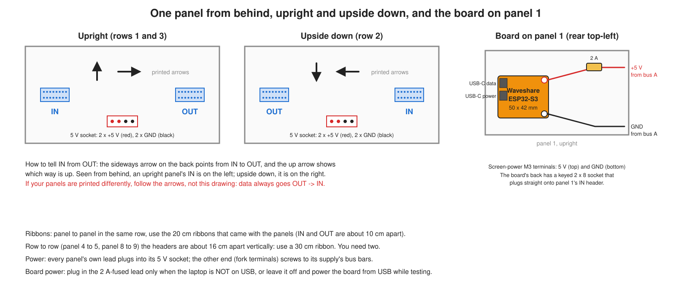
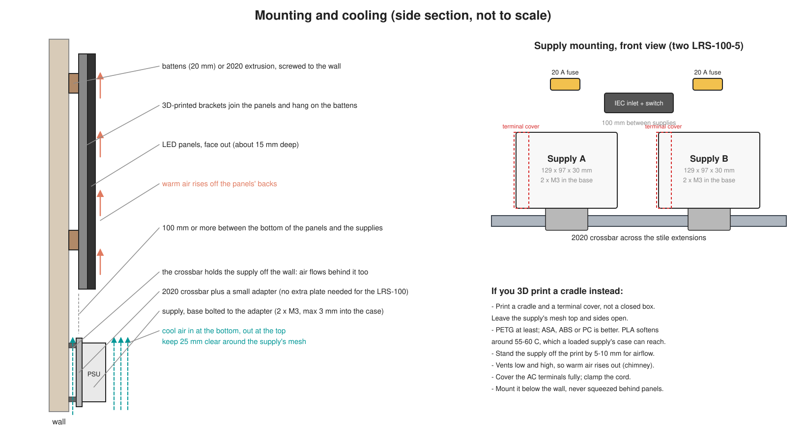

# Assembly guide: panels, wiring, controller and mounting

How the twelve P5 panels, the Waveshare controller and the supplies connect, and how to mount
it all so the supplies stay cool. The drawings are generated by
`docs/diagrams/make_diagrams.py`; current-measurement tests are in
[`power-wiring-guide.md`](power-wiring-guide.md).

> **Mains safety.** The supplies have exposed 120 V AC terminals. Wire with the cord
> unplugged, cover the AC terminals before plugging in, and connect every earth (⏚) terminal.
> If you're not comfortable with mains wiring, have an electrician do the AC side.

## 1. What connects to what

| Item | Connections |
| --- | --- |
| Each P5 panel | **IN** header (HUB75, 2 x 8 pins), **OUT** header, one 4-pin **5 V socket** (2 x +5 V, 2 x GND) |
| Each panel's included leads | one 20 cm HUB75 ribbon, one power lead (4-pin plug to red and black fork terminals) |
| Waveshare ESP32-S3-RGB-Matrix | keyed 2 x 8 **socket on its back that plugs straight onto panel 1's IN header**; USB-C data; USB-C power; two M3 **screen-power terminals** (5 V and GND); 50 x 42 mm, 2 x M2.5 holes |
| Mean Well LRS-100-5 (x2) | 1 L, 2 N, 3 ⏚, 4-5 −V, 6-7 +V; full-range input, no voltage switch |

From Waveshare's schematic: the board's HUB75 outputs go through two SN74HC245 buffers
powered from its 5 V rail, so it drives the panels at 5 V logic levels. Its data USB-C has
a reverse-current circuit on its 5 V line; its power-only USB-C and the screen-power
terminals connect straight to the 5 V rail.

## 2. Layout and chain order

Seen **from the front**, numbered by chain position (1 = the panel the controller plugs into):

```
          col 1     col 2     col 3     col 4
row 1   [  4  ] ← [  3  ] ← [  2  ] ← [  1  ]   upright        <- controller on panel 1
row 2   [  5  ] → [  6  ] → [  7  ] → [  8  ]   upside down
row 3   [ 12  ] ← [ 11  ] ← [ 10  ] ← [  9  ]   upright
```

This is the layout these panels fall into naturally, and the same one DJDevon3's build uses
("the controller will be in the top right position"; every second row upside down). It is
the HUB75 library's `CHAIN_TOP_RIGHT_DOWN`, and the firmware's panel map
(`firmware/lib/render/src/panel_map.h`) is tested pixel for pixel against that layout.

Seen **from behind** (how you'll wire it), everything is mirrored left to right: panel 1
and the controller are at the **top left**.

## 3. Telling IN from OUT, and which way is up



- The sideways arrow printed on the back points **from IN to OUT**; the up arrow shows which
  way is up.
- Seen from behind, an upright panel's IN is on the **left**; an upside-down panel's IN is on
  the **right**.
- If your panels are printed differently, follow the arrows rather than the drawings: data
  always goes OUT to the next panel's IN. The test pattern (section 7) catches mistakes.

## 4. Data and controller


1. Lay the panels face down in the layout above (so you see the backs: panel 1 at the top
   left). Rows 1 and 3 with the up arrows pointing up the wall, row 2 with them pointing down.
2. **In each row**, join each panel's OUT to the next panel's IN with the 20 cm ribbons that
   came with the panels (nine ribbons).
3. **Row to row**, join panel 4's OUT to panel 5's IN and panel 8's OUT to panel 9's IN. The
   headers are about 16 cm apart vertically, so use **30 cm ribbons** (two needed; the
   panels' 20 cm ones are too short).
4. Ribbons are keyed: the tab on the plug matches the notch in the header. Don't force one in
   the wrong way.
5. **Controller**: plug the Waveshare board straight onto panel 1's IN header (no ribbon).
   Secure it to the panel back with an M2.5 standoff or a printed clip so it doesn't hang
   on the header pins.
6. **Controller power**:
   - While testing at the bench: power it from the laptop through its **USB-C data** port and
     leave the supply lead disconnected.
   - Installed: a short red/black lead with a **2 A inline fuse** from bus A to the board's
     two M3 screen-power terminals (5 V and GND), with M3 ring terminals. Then you don't need
     USB at all; firmware updates go over Wi-Fi.
   - Don't connect the supply lead and a USB cable at the same time, and never plug a charger
     into the power-only USB-C while the supply lead is on: that port connects straight to
     the same 5 V rail.
7. The panels and the board share ground through the HUB75 header, and through the GND lead
   once it's fitted.

## 5. Power

### With the two LRS-100-5 supplies

Supply A powers panels 1 to 6 (front view: the top row and the left half of the middle row),
supply B panels 7 to 12. The firmware's power limiter assumes this split.

1. Each supply's +V goes through a **20 A fuse** to its **+ bus bar**; its −V goes to its
   **GND bus bar**. 14 AWG wire, or 12 AWG if the run is longer than 1 m.
2. Each panel's own lead plugs into its 5 V socket. Screw its red fork to its supply's + bar
   and its black fork to the GND bar, **in the slot with the panel's number** (bus A slots
   1-6, bus B slots 7-12, as in the drawing). With two-plug splitter leads, one lead feeds a
   pair: 1+2, 3+4, 5+6, 7+8, 9+10, 11+12.
3. **Join the two GND bus bars** with a 14 AWG jumper: the ribbon from panel 6 to panel 7
   crosses supplies, so the grounds must be common. **Never join the + bars.**
4. Mount each bus bar pair on insulated standoffs **behind the wall, close to its six
   panels** (A behind the upper half, B behind the lower half) so every panel lead reaches.
   The drawing shows them below the wall only to keep it readable.
5. AC: black (hot) to L, white (neutral) to N, green to ⏚, through one switched, fused inlet
   or power strip for the whole wall.

### With one Mean Well UHP-500-5


One 8 AWG lead per output terminal (two +V, two −V) to a pair of **main bus bars** rated
100 A, then four branches of three panels: 12 AWG with a **20 A fuse** each, to small branch
bars where the panels' forks screw on. After switching, set Settings → Power supplies to
1 supply, 80 A, 85% (details in `power-wiring-guide.md` section 4).

## 6. Mounting and cooling



### The wall

- Join the panels with DJDevon3's printed brackets
  ([Printables 578204](https://www.printables.com/model/578204-hub75-5mm-pitch-4-panel-bracket)),
  screwed into the panels' M3 posts. A 4 x 3 grid has **6 inside junctions** where four
  corners meet and **10 edge junctions** where two panels meet; his page has the variants.
- Hang the assembly on two horizontal battens (20 mm, wood or 2020 aluminium extrusion)
  screwed to the wall. That leaves an air gap behind the panels; they get warm at high
  brightness and the warm air needs to rise out.
- The whole wall is roughly 6 kg (12 panels at about 0.4 to 0.5 kg each, plus brackets).
  That's an estimate; weigh one panel. Use wall anchors rated well above it.

### The supplies (LRS-100-5)

What Mean Well's datasheet says about them:

| Fact | Value |
| --- | --- |
| Size, weight | 129 x 97 x 30 mm, 0.33 kg |
| Cooling | free air convection, no fan; the mesh case is the heat sink |
| Mounting | 2 x M3 in the base (screw at most 3 mm into the case), 3 x M3 on one side (at most 5 mm) |
| Temperature (5 V model) | 100% load up to 45 C ambient, falling to 60% at 70 C |
| Heat to get rid of | 86% efficient: at the 15.3 A budget (76 W out), about 12 W each |

Recommended mount, as in the drawing:

1. **One aluminium plate**, about 600 x 380 x 3 mm, holding both supplies side by side about
   100 mm apart, plus the fuse holders and the switched, fused AC inlet.
2. Bolt each supply's base to the plate with 2 x M3 (short screws: 3 mm into the case at most).
   The plate spreads heat and gives a solid, non-flammable mount.
3. Stand the plate **15 mm off the wall** on four standoffs, so air flows behind it as well.
4. Mount it **below the wall, at least 100 mm under the panels**, where the air is coolest.
   Don't put supplies behind the panels: the panels heat that air.
5. Keep **25 mm clear around each supply's mesh**, and nothing on top of it.
6. Cover the AC terminals (bought covers, or printed ones in PETG/ASA) and clamp the cords.

Mean Well's derating curve is for the supply mounted flat ("horizontal"). On a vertical
plate convection is a little weaker, so expect some derating. This wall normally runs well
under 10 A per supply, so there's plenty of margin; the 30-minute heat test in
`power-wiring-guide.md` confirms it on your wall.

### If you 3D print instead of using a plate

- Print a **cradle and terminal cover, not a closed box.** The supply's mesh top and sides
  must stay open; it's how the supply cools.
- **PETG at least; ASA, ABS or PC is better.** PLA starts to soften around 55 to 60 C, and a
  loaded supply's case can reach that in a warm room.
- Stand the supply **5 to 10 mm off** the print so air passes underneath.
- Vents low and high on the same face so warm air rises out (a chimney).
- The AC terminals must be fully covered and the cord clamped; printed plastic burns, so
  keep the 120 V side enclosed and the print away from anything hot.

### UHP-500-5

Mean Well rates it for its full 80 A only when it's **bolted to an aluminium plate 450 x 450
x 3 mm**, centred, with thermal grease, using the four M3 holes in its base. Without the
plate it is good for about 60% at 115 V. Mount that plate the same way: on standoffs, below
the wall, with clear air around it.

## 7. Check before closing it up

1. Test pattern (`power-wiring-guide.md` test 3): every panel shows its chain number in the
   layout of section 2, with every arrow pointing up, and a small red block in the top-right
   corner of panel 1. Panels 1 to 6 are framed in teal (supply A), 7 to 12 in orange
   (supply B). A wrong number means a ribbon is in the wrong place; a down arrow means that
   panel is mounted the wrong way round.
2. Current and heat (tests 4 and 5) with the supplies in their final mounting.
3. Wi-Fi: the board sits behind the panels. Check the signal on the console's Wall tab
   (Diagnostics). Weaker than about -75 dBm, move the router closer or use an access point
   near the wall.

## Knowns and unknowns

Known (from datasheets, schematics and source):
- LRS-100-5 terminals, size, mounting holes, derating and full-range input: Mean Well's
  datasheet (2025-04-07).
- UHP-500-5 plate requirement and terminals: Mean Well's datasheet (2024-03-12).
- Waveshare board: socket that plugs onto the panel, 5 V level shifting, USB and
  screen-power terminals, size and holes: Waveshare's schematic and drawing on GitHub.
- Chain order: the HUB75 library's `CHAIN_TOP_RIGHT_DOWN`, checked pixel for pixel by the
  firmware's native tests.

Not yet known (check on the real hardware):
- Where the IN and OUT headers and the 5 V socket sit on your panels, and the length of
  their power leads. The drawings assume the usual layout; follow the printed arrows.
- Whether the board's data USB-C really blocks reverse current when the supply lead is also
  connected. Until checked, don't connect both.
- Panel weight and how warm the panels run at your brightness.
- Wi-Fi signal through the panels.
