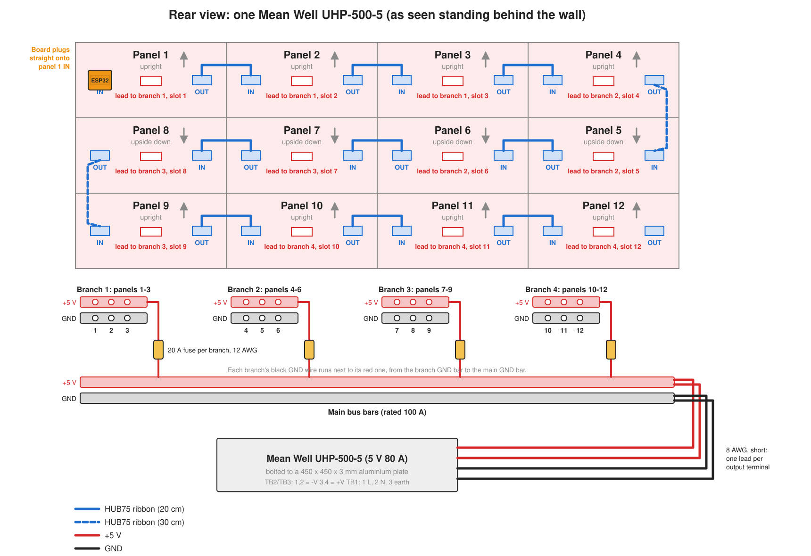
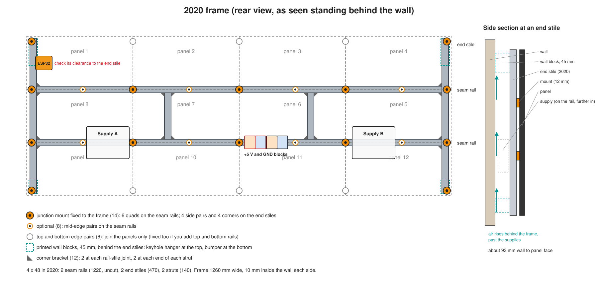

# Assembly guide: panels, wiring, controller and mounting

How the twelve P5 panels, the Waveshare controller and the supplies connect, and how to mount
it all so the supplies stay cool. The drawings are generated by
`docs/diagrams/make_diagrams.py`; current-measurement tests are in
[`power-wiring-guide.md`](power-wiring-guide.md).

> **Mains safety.** The supplies have exposed 120 V AC terminals. Wire with the cord
> unplugged, cover the AC terminals before plugging in, and connect every earth (⏚) terminal.
> If you're not comfortable with mains wiring, have an electrician do the AC side.

## 1. What connects to what

| Item | Connections |
| --- | --- |
| Each P5 panel | **IN** header (HUB75, 2 x 8 pins), **OUT** header, one 4-pin **5 V socket** (2 x +5 V, 2 x GND) |
| Each panel's included leads | one 20 cm HUB75 ribbon, one power lead (4-pin plug to red and black fork terminals) |
| Waveshare ESP32-S3-RGB-Matrix | keyed 2 x 8 **socket on its back that plugs straight onto panel 1's IN header**; USB-C data; USB-C power; two M3 **screen-power terminals** (5 V and GND); 50 x 42 mm, 2 x M2.5 holes |
| Mean Well LRS-100-5 (x2) | 1 L, 2 N, 3 ⏚, 4-5 −V, 6-7 +V; full-range input, no voltage switch |

From Waveshare's schematic: the board's HUB75 outputs go through two SN74HC245 buffers
powered from its 5 V rail, so it drives the panels at 5 V logic levels. Its data USB-C has
a reverse-current circuit on its 5 V line; its power-only USB-C and the screen-power
terminals connect straight to the 5 V rail.

## 2. Layout and chain order

Seen **from the front**, numbered by chain position (1 = the panel the controller plugs into):

```
          col 1     col 2     col 3     col 4
row 1   [  4  ] ← [  3  ] ← [  2  ] ← [  1  ]   upright        <- controller on panel 1
row 2   [  5  ] → [  6  ] → [  7  ] → [  8  ]   upside down
row 3   [ 12  ] ← [ 11  ] ← [ 10  ] ← [  9  ]   upright
```

This is the layout these panels fall into naturally, and the same one DJDevon3's build uses
("the controller will be in the top right position"; every second row upside down). It is
the HUB75 library's `CHAIN_TOP_RIGHT_DOWN`, and the firmware's panel map
(`firmware/lib/render/src/panel_map.h`) is tested pixel for pixel against that layout.

Seen **from behind** (how you'll wire it), everything is mirrored left to right: panel 1
and the controller are at the **top left**.

## 3. Telling IN from OUT, and which way is up


- The sideways arrow printed on the back points **from IN to OUT**; the up arrow shows which
  way is up.
- Seen from behind, an upright panel's IN is on the **left**; an upside-down panel's IN is on
  the **right**.
- If your panels are printed differently, follow the arrows rather than the drawings: data
  always goes OUT to the next panel's IN. The test pattern (section 7) catches mistakes.

## 4. Data and controller


1. Lay the panels face down in the layout above (so you see the backs: panel 1 at the top
   left). Rows 1 and 3 with the up arrows pointing up the wall, row 2 with them pointing down.
2. **In each row**, join each panel's OUT to the next panel's IN with the 20 cm ribbons that
   came with the panels (nine ribbons).
3. **Row to row**, join panel 4's OUT to panel 5's IN and panel 8's OUT to panel 9's IN. The
   headers are about 16 cm apart vertically, so use **30 cm ribbons** (two needed; the
   panels' 20 cm ones are too short).
4. Ribbons are keyed: the tab on the plug matches the notch in the header. Don't force one in
   the wrong way.
5. **Controller**: plug the Waveshare board straight onto panel 1's IN header (no ribbon).
   Secure it to the panel back with an M2.5 standoff or a printed clip so it doesn't hang
   on the header pins.
6. **Controller power**:
   - While testing at the bench: power it from the laptop through its **USB-C data** port and
     leave the supply lead disconnected.
   - Installed: a short red/black lead with a **2 A inline fuse** from bus A to the board's
     two M3 screen-power terminals (5 V and GND), with M3 ring terminals. Then you don't need
     USB at all; firmware updates go over Wi-Fi.
   - Don't connect the supply lead and a USB cable at the same time, and never plug a charger
     into the power-only USB-C while the supply lead is on: that port connects straight to
     the same 5 V rail.
7. The panels and the board share ground through the HUB75 header, and through the GND lead
   once it's fitted.

## 5. Power

### With the two LRS-100-5 supplies

Supply A powers panels 1 to 6 (front view: the top row and the left half of the middle row),
supply B panels 7 to 12. The firmware's power limiter assumes this split.

1. Each supply's +V goes through a **20 A fuse** to its **+ bus bar**; its −V goes to its
   **GND bus bar**. 14 AWG wire, or 12 AWG if the run is longer than 1 m.
2. Each panel's own lead plugs into its 5 V socket. Screw its red fork to its supply's + bar
   and its black fork to the GND bar, **in the slot with the panel's number** (bus A slots
   1-6, bus B slots 7-12, as in the drawing). With two-plug splitter leads, one lead feeds a
   pair: 1+2, 3+4, 5+6, 7+8, 9+10, 11+12.
3. **Join the two GND bus bars** with a 14 AWG jumper: the ribbon from panel 6 to panel 7
   crosses supplies, so the grounds must be common. **Never join the + bars.**
4. Mount each bus bar pair on insulated standoffs **behind the wall, close to its six
   panels** (A behind the upper half, B behind the lower half) so every panel lead reaches.
   The drawing shows them below the wall only to keep it readable.
5. AC: black (hot) to L, white (neutral) to N, green to ⏚, through one switched, fused inlet
   or power strip for the whole wall.

### With one Mean Well UHP-500-5



One 8 AWG lead per output terminal (two +V, two −V) to a pair of **main bus bars** rated
100 A, then four branches of three panels: 12 AWG with a **20 A fuse** each, to small branch
bars where the panels' forks screw on. After switching, set Settings → Power supplies to
1 supply, 80 A, 85% (details in `power-wiring-guide.md` section 4).

## 6. Mounting and cooling


### The wall: aluminium extrusion frame (recommended)



A 2020 frame holds every panel at its corners on 30 mm standoffs, carries the bus bars and
the supplies, and hangs on the wall as one unit.

- **Rails behind every line where panels meet.** Four horizontal 2020 rails: two centred on
  the row seams, and two centred 15 mm in from the wall's top and bottom edges, where the
  edge mounts' inserts are. Each rail stops 5 mm short of the wall's sides, so none of the
  frame shows from the front. A frame round the outside only would leave panels 6 and 7
  (the middle of row 2) unsupported: they touch no outer edge.
- **Stiles behind the rails** (wall side): three vertical 2020 lengths, joined to each rail
  at the 12 crossings with two right-angle 2020 corner brackets (one above the rail, one
  below), each bridging the stile's front face and the rail's top or bottom face. Flat
  T-plates don't work here: the rails and stiles sit in different planes. Running them on about 330 mm below the
  bottom rail carries a crossbar for the supplies, so they sit at least 100 mm under the panels.
- **Junction mounts** (printed parts in [`hardware/`](../hardware/README.md)). Each panel has
  six M3 posts on its back: one about 6 mm in from each corner and one at the middle of each
  long edge. A mount screws onto the posts of the panels that meet there (M3 x 10 into
  counterbores, no washers) and carries an M5 heat-set insert for the standoff:

  

  | Mount | Where | Number |
  | --- | --- | --- |
  | quad | where four panel corners meet, on a seam rail | 6 |
  | pair | two corners across a seam at the wall's edge: 6 on the top and bottom edges, 4 on the sides | 10 |
  | corner | the wall's four outer corners | 4 |
  | pair (optional) | the mid-edge posts across each row seam, halfway along each panel | 8 |

  A pair's and a corner's insert sits 9 mm in from its posts, clear of the screw heads, so
  every insert lands on a rail: the side pairs and the quads on the seam rails, the top and
  bottom pairs and the corners on the edge rails. Print them in **PETG or ASA**, not PLA:
  they carry the wall's weight and the panel backs get warm.
- **How they fix to the rails.** A screw can't reach a T-nut from the panel side, so the
  rails are drilled instead. Lay the panel assembly face down, screw a 30 mm M5 standoff
  (male-female) into each mount's insert, lay the rails on top, and drive an M5 screw from
  the back through a **5.5 to 6.5 mm hole drilled through the rail** into each standoff. Mark
  the holes from the assembled panels; the slightly oversized hole takes up about 0.5 mm of
  error. Then add the stiles and hang the whole unit. To service a panel, take the unit down
  and lay it face down (two people, about 11 kg).
- **Which junctions to fix.** Every panel post that has a mount on it is held by that mount;
  only the mounts connect to the frame. Minimum 14: all 10 on the two seam rails (they hold
  every middle-row corner and half of each outer panel) plus the 4 outer corners.
  Recommended: all 20, so the top and bottom seams stay flush. The 8 optional mid-edge pairs
  hold the long row seams halfway along; add them if a seam bows. Fit everything loosely, push the panels flush,
  then tighten; the T-nuts can slide a little, so the plastic panels and aluminium frame
  don't fight as the temperature changes.
- **Stile joints.** Two side stiles carry the load (a 1.27 m 2020 rail sags only about
  0.7 mm under its share of the panels, by beam calculation); the centre stile adds a middle
  wall fixing and support for the supply crossbar. Join each rail-stile crossing with two
  metal right-angle corner brackets: these joints carry the whole wall in shear, and printed
  plastic clamped under a screw slowly creeps and loosens. Print the rest (cable clips, bus
  bar standoffs, end caps, adapters, wall spacers); if you do print crossing joints, use ASA
  or PC, 8 mm or thicker under the screws, metal washers, and re-tighten after a week.
- **30 mm standoff** between the panel backs and the rails clears the ribbon and power plugs,
  lets the two row-to-row ribbons pass over the seam rails, and leaves an air gap behind
  the panels. Wall to panel face is about 95 mm.
- **Bus bars** mount on the seam rails on insulated standoffs in T-nuts: bus A on the upper
  seam rail behind its panels, bus B on the lower one. Supply feeds run down the stiles,
  clipped into the slots.
- **Hanging it:** angle brackets from the stiles to the wall, or a French cleat across the
  top rail. The panels (about 6 kg, an estimate), about 3.7 kg of extrusion and the supply
  supplies add up to roughly 10 kg: use anchors rated well above that.

| Cut list | Quantity | Length |
| --- | --- | --- |
| 2020 rail | 4 | about 1270 mm (wall width less 5 mm each end) |
| 2020 stile | 3 | about 830 mm (wall height less the insets, plus 330 mm below for the supplies) |
| 2020 supply crossbar | 1 | about 1150 mm, across the outer stiles below the panels (from the spare length) |

| Hardware | Quantity |
| --- | --- |
| Junction mounts (`hardware/stl`), PETG or ASA, an M5 heat-set insert each | 20: 6 quad, 10 pair, 4 corner (plus 8 pair if you fit the optional ones) |
| M5 standoffs, 30 mm, male-female | 20 (28) |
| M5 x 30 screws and washers (through the rail into the standoff) | 20 (28) |
| M3 x 10 socket head screws into the panels' posts (no washers: the mounts are counterbored) | 48 (64) |
| M5 drop-in T-nuts and screws (bus bars, cable clips, supply adapters, crossbar) | about 25 |
| Metal 2020 right-angle corner brackets (2 per rail-stile crossing) | 24 |

**Test-fit one first.** The 6 mm post position is scaled from the supplier's photo of the
panel's back, so it is good to about 1 mm. Print one quad and screw it onto four panels
laid face down: if the screws start without forcing, print the rest. If not, measure post
centre to panel edge, set `POST_INSET` in `hardware/mounts.py` and run it again (see
[`hardware/README.md`](../hardware/README.md)). While the panels are face down, check how far
the connectors stand off the back: if more than about 25 mm, lengthen the standoffs.

### The wall: battens (simpler alternative)

- Join the panels with DJDevon3's printed brackets
  ([Printables 578204](https://www.printables.com/model/578204-hub75-5mm-pitch-4-panel-bracket)),
  screwed into the panels' M3 posts: 6 inside junctions and 10 edge junctions.
- Hang the assembly on two horizontal battens (20 mm, wood or 2020 extrusion) screwed to the
  wall, which leaves an air gap behind the panels.
- The whole wall is roughly 6 kg (12 panels at about 0.4 to 0.5 kg each, plus brackets).
  That's an estimate; weigh one panel. Use wall anchors rated well above it.

### The supplies (LRS-100-5)

What Mean Well's datasheet says about them:

| Fact | Value |
| --- | --- |
| Size, weight | 129 x 97 x 30 mm, 0.33 kg |
| Cooling | free air convection, no fan; the mesh case is the heat sink |
| Mounting | 2 x M3 in the base (screw at most 3 mm into the case), 3 x M3 on one side (at most 5 mm) |
| Temperature (5 V model) | 100% load up to 45 C ambient, falling to 60% at 70 C |
| Heat to get rid of | 86% efficient: at the 15.3 A budget (76 W out), about 12 W each |

**No extra plate is needed.** Mean Well rates the LRS-100 as it comes ("cooling by free air
convection"; the derating above is for the supply alone), and its metal case is the heat
sink. The 360 x 360 x 1 mm metal plate in the datasheet's notes is for EMC testing, not
cooling. (The UHP-500-5 is different: it does need its plate, see below.)

Recommended mount, as in the drawings:

1. **A crossbar** on the frame: one horizontal 2020 between the outer stile extensions,
   below the panels (the spare 1500 mm length from the second extrusion pack covers it).
   Without the frame, any metal or wood batten on the wall does the same job.
2. **Bolt each supply's base to a small adapter** (a short piece of aluminium flat bar, or a
   printed PETG/ASA bracket), then the adapter to the crossbar with M5 T-nuts. Mean Well
   allows **3 mm at most** into the case through the base's 2 x M3 holes, so the screw length
   is the adapter's thickness plus 3 mm, no more. The 3 x M3 holes in one side (5 mm at most)
   are an alternative.
3. Mount the AC inlet and the fuse holders on the same crossbar.
4. **Below the wall, at least 100 mm under the panels**, where the air is coolest. Don't put
   supplies behind the panels: the panels heat that air.
5. Keep **25 mm clear around each supply's mesh**, nothing on top of it, and an air gap
   behind (the crossbar holds the supplies off the wall).
6. Cover the AC terminals (bought covers, or printed ones in PETG/ASA) and clamp the cords.

Mean Well's derating curve is for the supply mounted flat ("horizontal"). Mounted on a
vertical surface, convection is a little weaker, so expect some derating. This wall normally
runs well under 10 A per supply, so there's plenty of margin; the 30-minute heat test in
`power-wiring-guide.md` confirms it on your wall.

### If you 3D print a cradle or enclosure

- Print a **cradle and terminal cover, not a closed box.** The supply's mesh top and sides
  must stay open; it's how the supply cools.
- **PETG at least; ASA, ABS or PC is better.** PLA starts to soften around 55 to 60 C, and a
  loaded supply's case can reach that in a warm room.
- Stand the supply **5 to 10 mm off** the print so air passes underneath.
- Vents low and high on the same face so warm air rises out (a chimney).
- The AC terminals must be fully covered and the cord clamped; printed plastic burns, so
  keep the 120 V side enclosed and the print away from anything hot.

### UHP-500-5

Mean Well rates it for its full 80 A only when it's **bolted to an aluminium plate 450 x 450
x 3 mm**, centred, with thermal grease, using the four M3 holes in its base. Without the
plate it is good for about 60% at 115 V. Fix that plate to the stile extensions below the
wall, with an air gap behind it and clear air around it.

## 7. Check before closing it up

1. Test pattern (`power-wiring-guide.md` test 3): every panel shows its chain number in the
   layout of section 2, with every arrow pointing up, and a small red block in the top-right
   corner of panel 1. Panels 1 to 6 are framed in teal (supply A), 7 to 12 in orange
   (supply B). A wrong number means a ribbon is in the wrong place; a down arrow means that
   panel is mounted the wrong way round.
2. Current and heat (tests 4 and 5) with the supplies in their final mounting.
3. Wi-Fi: the board sits behind the panels. Check the signal on the console's Wall tab
   (Diagnostics). Weaker than about -75 dBm, move the router closer or use an access point
   near the wall.

## 8. Parts list with Amazon links

Quantities are for the two LRS-100-5 supplies and the extrusion frame; the UHP-500-5
differences are at the end. These are listings found by search, not products I have
tested: specs are the sellers' claims, and prices and stock change, so check each listing's
size and contents before ordering. Links reused from DJDevon3's build are marked.

### Power and wiring

| Part | For | Qty | Link | Check |
| --- | --- | --- | --- | --- |
| 6-terminal bus bar with cover, red and black pair (M4 screws, 2 M6 studs, 150 A DC) | + and GND bars, one pair per supply | 2 pairs | [PSEQT pair](https://www.amazon.com/dp/B08HRGHTN1) | Your panel leads' fork terminals fit an M4 screw (most #8 forks do). Alternative single bar: [JOYHO](https://www.amazon.com/dp/B07S2F26X3) |
| Inline ATC fuse holders, 14 AWG, with assorted fuses (1 to 30 A) | 20 A on each supply's +V feed; 2 A on the controller lead | 1 kit | [SIM&NAT 10-pack + 50 fuses](https://www.amazon.com/dp/B07FQCBSJ5) | Includes both 20 A and 2 A fuses |
| 12 AWG silicone wire, red and black, 25 ft each | Supply-to-bus feeds, GND jumper | 1 | [BNTECHGO](https://www.amazon.com/dp/B07BS5YNCF) | |
| Ring terminals, 12-10 AWG, M6 | Feeds onto the bus bars' M6 studs | 1 pack | [Hilitchi 100 pcs](https://www.amazon.com/dp/B01D8EJX3E) | |
| Ferrule crimping kit (AWG 23-10) | Wire ends into the supplies' terminal screws | 1 | [Preciva](https://www.amazon.com/dp/B07XBLGPCY) | |
| AC inlet with switch and fuse (IEC C14) | One switch for the wall | 1 | [DJDevon3's pick](https://www.amazon.com/dp/B07RQV2NPN) | Plus any 3-prong PC power cord |
| HUB75 ribbon, 30 cm | Row-to-row hops (panel 4 to 5, 8 to 9) | 2 or more | [DJDevon3's pick](https://www.amazon.com/dp/B07FZWH9S6) | The panels' own 20 cm ribbons do the rest |
| DC clamp meter, 2 A / 20 A / 100 A DC ranges | Current tests | 1 | [UNI-T UT210E](https://www.amazon.com/dp/B0188WD1NE) | Must say DC current; 1 mA resolution on the 2 A range |

### Frame

| Part | For | Qty | Link | Check |
| --- | --- | --- | --- | --- |
| 2020 V-slot extrusion, 1500 mm, 4-pack | 4 rails (cut to 1270), 3 stiles (cut to 830), 1 crossbar (cut to 1150) | 2 packs (all 8 lengths used) | [MECCANIXITY 4 x 1500 mm](https://www.amazon.com/dp/B0GFDP1Z34) | Cut square with a metal-cutting blade, or buy cut to length from an extrusion supplier |
| 2020 right-angle corner brackets with M5 T-nuts and screws | Rail-stile crossings, 2 each | 24 (3 x 10-sets) | [KOOTANS 10-set](https://www.amazon.com/dp/B07PZKRTYZ) | |
| M5 drop-in T-nuts, 2020 series | Bus bars, supply adapters, crossbar, cable clips | 1 pack | [60 pcs](https://www.amazon.com/dp/B0FKWJQ5NS) | |
| M5 heat-set inserts | One per junction mount | 20, or 28 with the optional pairs (plus spares) | [initeq M5, 20 pcs](https://www.amazon.com/dp/B077CJ26FL) | The mounts print a 6.4 mm hole; if the insert maker gives another size, set `INSERT_D` in `hardware/mounts.py` |
| M5 standoffs, 30 mm, male-female | Mount to rail | 20 (28) | [Brass M5, choose 30 mm](https://www.amazon.com/dp/B0GYQN95GB) | Pick M5 and 30 mm in the listing's options; the male thread adds about 8 mm |
| M5 x 30 socket head screws | Through the drilled rail into each standoff | 20 (28) | [Newport 50-pack](https://www.amazon.com/dp/B082GH7JW6) | |
| M3 x 10 socket head screws | Mounts into the panels' posts | 48 (64) | [100 pcs with washers](https://www.amazon.com/dp/B091N1J6F8) | The washers aren't needed |
| M3 x 6 screws (adapter 3 mm thick + at most 3 mm into the case) | Supplies onto their adapters | 4 | from any M3 assortment | Match the length to your adapter: never more than 3 mm into the supply |
| Aluminium flat bar, about 25 x 3 mm, or printed PETG/ASA | Supply adapters | 2 short pieces | any hardware store | |
| PETG or ASA filament | Junction mounts, cable clips, terminal covers | 1 spool | any brand | Not PLA |

### If you move to one UHP-500-5

- The supply: [Mean Well UHP-500R-5 on Amazon](https://www.amazon.com/dp/B07ZJCSF65), or the UHP-500-5 from a distributor (TRC Electronics, Digi-Key).
- Bus bars: 5 pairs instead of 2 (one main pair plus one per branch).
- Aluminium plate: 450 x 450 x 3 mm, as Mean Well requires for this supply: a 24 x 24 in 1/8 in 6061 sheet, cut down.
- 8 AWG wire, red and black, about 1 m each, and 8 AWG ring terminals for the supply-to-main-bus leads.
- Thermal grease between the supply and its plate.

## Knowns and unknowns

Known (from datasheets, schematics and source):
- LRS-100-5 terminals, size, mounting holes, derating and full-range input: Mean Well's
  datasheet (2025-04-07).
- UHP-500-5 plate requirement and terminals: Mean Well's datasheet (2024-03-12).
- Waveshare board: socket that plugs onto the panel, 5 V level shifting, USB and
  screen-power terminals, size and holes: Waveshare's schematic and drawing on GitHub.
- Chain order: the HUB75 library's `CHAIN_TOP_RIGHT_DOWN`, checked pixel for pixel by the
  firmware's native tests.

Not yet known (check on the real hardware):
- Where the IN and OUT headers and the 5 V socket sit on your panels, and the length of
  their power leads. The drawings assume the usual layout; follow the printed arrows.
- Whether the board's data USB-C really blocks reverse current when the supply lead is also
  connected. Until checked, don't connect both.
- Panel weight and how warm the panels run at your brightness.
- Wi-Fi signal through the panels.
