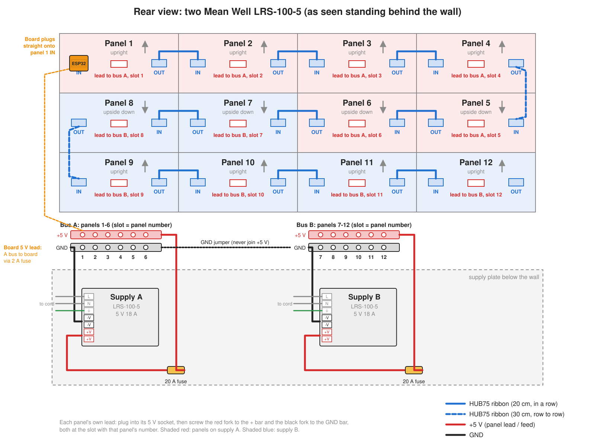
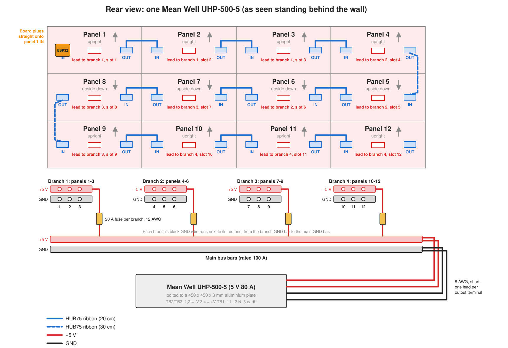

# Power wiring and test guide

How to wire the twelve P5 panels with the two Mean Well LRS-100-5 supplies you have now,
how to measure what the wall really draws, and how to wire a single Mean Well UHP-500-5 if
you move to one.

> **Mains safety.** The supplies have exposed 120 V AC terminals. Do all wiring with the
> cord unplugged, cover the AC terminals before plugging in, and connect every earth (FG / ⏚)
> terminal. If you're not comfortable with mains wiring, have an electrician do the AC side;
> the 5 V side is low voltage but carries enough current to melt undersized wire.

## 1. Which panel is which

The full layout, with drawings, is in [`assembly-guide.md`](assembly-guide.md) section 2. In
short, numbered by chain position (1 = the panel the controller plugs into), **seen from the
front**:

```
          col 1     col 2     col 3     col 4
row 1   [  4  ] ← [  3  ] ← [  2  ] ← [  1  ]   upright      (controller on panel 1)
row 2   [  5  ] → [  6  ] → [  7  ] → [  8  ]   upside down
row 3   [ 12  ] ← [ 11  ] ← [ 10  ] ← [  9  ]   upright
```

With two supplies, **supply A powers panels 1 to 6 and supply B powers panels 7 to 12**,
seen from the front:

```
row 1   [ A ] [ A ] [ A ] [ A ]
row 2   [ A ] [ A ] [ B ] [ B ]
row 3   [ B ] [ B ] [ B ] [ B ]
```

Keep this split. With "Power supplies" set to 2 (Settings tab, the default), the power
limiter assumes exactly these panels on each supply (`web/power.js`). If you wire it
differently, the limiter protects the wrong supply.

## 2. Current per panel (what to plan for)

| Figure | Per panel | 6 panels (one LRS-100-5) | 12 panels |
| --- | --- | --- | --- |
| Full white, 100% (seller spec) | 4.9 A | 29.5 A | 59 A |
| Full white, 100% (Waveshare, PMD Way) | 4.0 A | 24 A | 48 A |
| LRS-100-5 rating | | **18 A** (firmware budget 15.3 A) | |

With the LRS-100-5s, all-white can't reach 100%. The firmware dims any frame that would pass
15.3 A on either supply. Section 5 measures where the real limit is.

## 3. Wiring with the two LRS-100-5 supplies



### Parts

| Part | Quantity | Notes |
| --- | --- | --- |
| Mean Well LRS-100-5 | 2 | You have these |
| IEC inlet with switch and fuse, plus a 3-prong cord | 1 or 2 | Or one switched power strip; one switch for the whole wall |
| Bus bar pair (+ and GND), 6 screw positions, insulated mounts | 2 | One pair per supply; the panels' fork terminals screw on here |
| 14 AWG stranded wire, red and black | about 3 m each | Supply to its bus bars (12 AWG if the run is over 1 m) |
| Inline blade fuse holder, 14 AWG, with 20 A fuse | 2 | On each supply's +V feed |
| 14 AWG jumper wire | 30 cm | Joins the two GND bus bars |
| 2 A inline fuse, 20 AWG red/black, two M3 ring terminals | 1 set | Controller power lead |
| Ring or fork terminals for the supply screws, plus ferrules | 1 pack | No bare stranded wire under a screw |
| Terminal covers (bought or printed) | 2 | Over the AC terminals |
| Multimeter | 1 | DC volts |
| **DC-capable** clamp meter | 1 | Many clamp meters measure AC only. Check it says "DC A" |

The panels' own power leads (4-pin plug on one end, red and black fork terminals on the
other) connect each panel to its bus bars. If yours are splitters with two plugs on one
lead, one lead powers two neighbouring panels: pair them 1+2, 3+4, 5+6, 7+8, 9+10, 11+12.

### LRS-100-5 terminals

From Mean Well's datasheet (case 238A), left to right on the terminal block:

```
 [ 1 L ] [ 2 N ] [ 3 ⏚ ] [ 4 -V ] [ 5 -V ] [ 6 +V ] [ 7 +V ]   (V.ADJ knob next to them)
```

**There is no input voltage switch:** the LRS-100 is full-range (85 to 264 V AC) and gives
full output from 115 V up, so it runs from a US outlet as it comes.

### Steps

1. Mount both supplies as in [`assembly-guide.md`](assembly-guide.md) section 6: bolted by
   their bases to the frame's crossbar (no extra plate needed for the LRS-100), with air around
   them, below the wall, never squeezed behind the panels.
2. AC side, cord unplugged: black (hot) to L, white (neutral) to N, green to ⏚. Fit the
   terminal cover.
3. Each supply: +V (terminal 6 or 7) through the 20 A fuse to its + bus bar; −V (terminal 4
   or 5) to its GND bus bar. 14 AWG; 12 AWG if the run is longer than 1 m.
4. Each panel: plug its lead into the panel's 5 V socket, then screw the red fork to its
   supply's + bar and the black fork to the GND bar, in the slot with the panel's number.
5. Join the two GND bus bars with the 14 AWG jumper. The data ribbon between panels 6 and 7
   crosses from one supply to the other, so the grounds must be common.
   **Never connect supply A's + bar to supply B's.**
6. Controller power (see [`assembly-guide.md`](assembly-guide.md) section 4): during testing,
   power the board from the laptop through its USB-C data port and leave the supply lead off.
   For the permanent install, run the 2 A-fused red/black lead from bus A to the board's two
   M3 "screen power" terminals (5 V and GND). Don't connect both at once.
7. HUB75 data: the board plugs straight onto panel 1's IN header; then OUT to IN along the
   chain, as in the drawing.

## 4. Wiring with one Mean Well UHP-500-5

### Mounting (required, not optional)

Mean Well's datasheet rates the UHP-500 for its full current only when it's **bolted to an
aluminum plate 450 × 450 × 3 mm** (or a metal cabinet of that size): centred, flat, with
thermal grease, using the four M3 holes in the bottom. Without the plate, at 115 V it's good
for only about 60% (about 48 A). The aluminum backing or frame the panels hang on can be the
plate if it's that size and the supply has open air around it.

### Terminals (from the datasheet)

```
 AC input TB1:   1 = L    2 = N    3 = ⏚ earth             (torque 5 kgf·cm)
 DC output TB2/TB3:  1, 2 = −V     3, 4 = +V                (torque 8 kgf·cm)
```

Input is 90 to 264 V AC, full output from 110 V up, so no voltage switch to set.

### Parts (in addition to the cord, strip, meters and connectors above)

| Part | Quantity | Notes |
| --- | --- | --- |
| Aluminum plate 450 × 450 × 3 mm, thermal grease, 4 M3 screws | 1 | Or the wall's frame, if it's that size |
| Bus bar pair (+ and −), rated 100 A or more | 1 | Or two high-current distribution blocks |
| 8 AWG wire, red and black, about 0.5 m each | 2 of each | Supply to bus bars, one per terminal pair |
| 12 AWG wire, red and black | about 3 m each | Bus bars to branches |
| Inline fuse holder, 12 AWG, with 20 A fuse | 4 | One per branch |

### Diagram



Each branch's bars hold three panels' fork terminals, in the slots with their panel numbers.
The controller's 2 A-fused lead comes from branch 1's bars.

At full white each branch carries about 12 to 15 A, comfortably inside 12 AWG and a 20 A fuse.
Use both terminal pairs on the supply (one 8 AWG lead per terminal), not just one pair.

Firmware: after switching, open the console's Settings tab and, under "Power supplies", set
**Supplies: 1, Amps each: 80, Budget %: 85**, then Save. The wall then counts all twelve
panels against one 68 A budget (80 A x 85%), so full white at 100% (about 59 A) is no longer
dimmed. The same over the API:
`PUT /api/settings {"power": {"supplies": 1, "rated_a": 80, "budget_pct": 85}}`.

Only use 80 A with the supply bolted to its aluminium plate. Without the plate it is good
for about 48 A at 115 V: set Amps each to 48 until the plate is fitted. Going back to the two
LRS-100-5s, set Supplies: 2, Amps each: 18, Budget %: 85.

## 5. Tests

Do these in order. Record the numbers in the table at the end and send them over; they set
the firmware's power model to your real panels.

### Firmware builds you'll use

From the `firmware/` folder, with the board on USB-C:

```
# Panel order and orientation
PLATFORMIO_BUILD_FLAGS="-DWALL_TEST_PATTERN" ../.tools/pio-venv/bin/pio run -e display_dev -t upload

# Current measurements, 18 A supplies (brightness capped at 50% so a stray key can't trip them)
PLATFORMIO_BUILD_FLAGS="-DWALL_CALIBRATE -DWALL_CALIBRATE_MAX_PCT=50" ../.tools/pio-venv/bin/pio run -e display_dev -t upload

# Current measurements, UHP-500-5 (no cap)
PLATFORMIO_BUILD_FLAGS="-DWALL_CALIBRATE" ../.tools/pio-venv/bin/pio run -e display_dev -t upload

# Serial monitor (keys are sent from here)
../.tools/pio-venv/bin/pio device monitor
```

In calibration mode the power limiter is off. Keys: `w` white, `h` mid grey, `r` `g` `b`
single colours, `k` off; `1` to `9` set 10 to 90% brightness, `0` sets 100%. It starts black
at 10%.

### Test 1: supplies alone (no panels connected)

1. Plug in, switch on. The supply's LED lights.
2. Measure +V to −V at the supply terminals: about 5.0 V.
3. Turn V.ADJ to **5.10 V**. (You'll fine-tune under load in test 5.)
4. Switch off and wait for the LED to go out before connecting anything.

### Test 2: one panel

Connect only panel 1 (power from bus A, slot 1; the board plugged onto its IN header). Flash the test pattern
build. Panel 1 shows "1", a border and an up arrow. If it's blank or noisy, rebuild with
`-DWALL_DRIVER_FM6126A` added. If the board reboots in a loop, see `README.md` (flash mode).

### Test 3: the whole chain

Connect all 12 panels. Each panel shows its chain number, in the layout of section 1, with
every arrow pointing up. A panel with the wrong number is in the wrong place in the chain;
an arrow pointing down means that panel is mounted the wrong way round. Note the refresh
rate printed in the serial log at boot.

### Test 4: current measurements

Flash the calibration build (capped at 50% on the LRS-100-5s). Clamp the DC clamp meter
around **that supply's +V feed** (the fused red wire from the supply to its + bus bar). Use
the +V side: the GND bars are joined between the supplies, so return current can split
between them and the reading would be off. With the UHP-500-5, clamp both 8 AWG +V leads
together (both inside the jaw). Zero the
clamp meter (DC zero button) before each reading.

For each line in the table, set the pattern and brightness, wait 10 seconds, and read:

- the current for each supply
- the voltage at the **farthest panel** on each bus (meter probes on that panel's 5 V
  socket, + and −)

Watch for flicker or the wall blinking off and on: that's the supply's overload protection
("hiccup"). If it happens, press `k` at once and note which line it was.

### Test 5: heat soak (30 minutes)

- LRS-100-5s: white at 50%. UHP-500-5: white at 100%.
- After 30 minutes, check: no flicker; farthest-panel voltage still 4.8 V or more (if not,
  turn V.ADJ up a little, no higher than 5.3 V at the supply); the supply case is hot but
  you can keep a hand on it for a few seconds. With the UHP-500-5, the case must stay
  under 80 °C (an IR thermometer helps).

### Test 6: real content

Flash the normal firmware (`pio run -e wall -t upload`), set brightness to what you plan to
use, and measure each supply while the PR whiteboard, the logo slide and your brightest
photo or video are on screen.

### Results table

| Line | Pattern | Brightness | Supply A (A) | Supply B (A) | Farthest panel volts | Notes |
| --- | --- | --- | --- | --- | --- | --- |
| 1 | off (`k`) | 10% | | | | baseline: board and idle panels |
| 2 | white | 20% | | | | |
| 3 | white | 30% | | | | |
| 4 | white | 50% | | | | |
| 5 | mid grey | 50% | | | | |
| 6 | red | 50% | | | | |
| 7 | white | 100% | | | | **UHP-500-5 only** |
| 8 | PR whiteboard | planned | | | | test 6 |
| 9 | brightest photo | planned | | | | test 6 |
| 10 | after 30 min soak | | | | | test 5 |

### Reading the results

- **Per-panel full-white current** ≈ line 4 (white at 50%) × 2 ÷ 6 for each LRS-100-5, or line
  7 ÷ 12 for the UHP-500-5. Lines 2 to 4 show whether current rises in a straight line with
  brightness. If line 4 isn't about 2.5 × line 2, the doubling is an estimate, so say so.
- **Keep the LRS-100-5s** if your real content (lines 8 and 9) at your planned brightness
  stays under about 15 A per supply. The limiter takes care of rare bright frames.
- **Upgrade** if lines 8 or 9 come close to 15 A, or if you want all-white at full brightness:
  white at 100% for 6 panels is roughly 2 × line 4.
- **Voltage** at the farthest panel under 4.8 V means a wire run is too thin or too long, or
  V.ADJ needs a small increase.

Send me the filled-in table. I'll set the per-panel figure (`PANEL_FULL_WHITE_A`) in the
firmware. The supply rating and budget are yours to set in Settings > Power supplies (one
or two supplies, amps each, budget %), so the limiter dims only when it has to.
