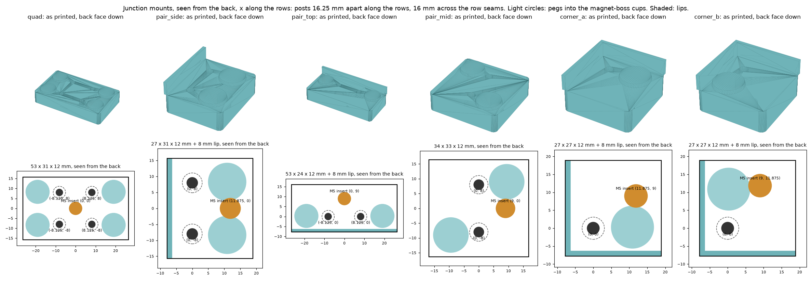
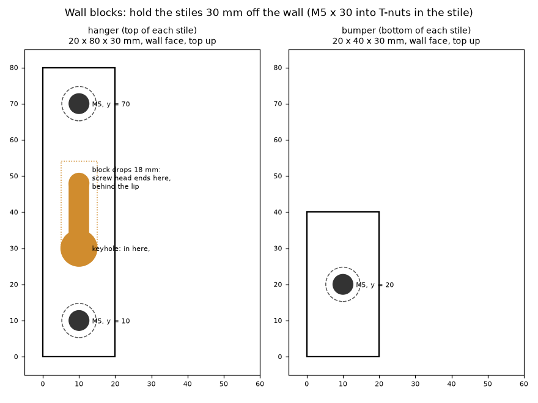
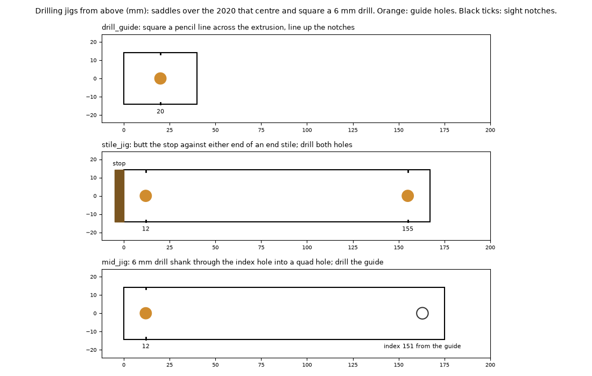

# Printed parts

Junction mounts that hold the panels to the 2020 frame, the blocks that hold the frame
45 mm off the wall, and the jigs for drilling the frame. Where they go, and the screws they
take, is in [the assembly guide](../docs/assembly-guide.md), section 6.



| File | Part | Print |
| --- | --- | --- |
| `stl/quad.stl` | Four panel corners; its long side and pegs go along the rows | 6 |
| `stl/pair_side.stl` | Two corners across a row seam at the wall's left or right edge, with a lip; onto an end stile | 4 |
| `stl/pair_top.stl` | Two corners across a seam on the wall's top or bottom edge, with a lip; joins the panels only | 6 |
| `stl/pair_mid.stl` | Two mid-edge posts across a row seam, no lip; onto a seam rail | 8 (optional) |
| `stl/corner_a.stl` | Outer corner, lips down both outer sides; seen from behind, bottom-left and top-right | 2 |
| `stl/corner_b.stl` | The mirror image: top-left and bottom-right | 2 |
| `stl/hanger.stl` | Top of each end stile: keyhole that hangs on a screw in the wall | 2 |
| `stl/bumper.stl` | Bottom of each end stile: rests on the wall | 2 |



## Printing

- PETG or ASA, not PLA: the mounts carry the wall and sit on warm panel backs.
- Print flat, as the STL is oriented, with no supports. Mounts: back face down (the
  counterbores and the insert hole on the bed), so the lips and the pegs
  point up. Wall blocks: the wall face (counterbores and keyhole) down; the keyhole's
  pocket bridges 10 mm.
- 4 walls, 40% infill or more, 0.2 mm layers. The holes need to be round, so check that the
  slicer isn't using a coarse arc resolution.
- Press an M5 heat-set insert into each fixed mount's 6.4 mm hole (on the back face) with a
  soldering iron, flush with the face, and let it cool before loading it.

## Fit one before printing the rest

The post spacing is measured with a caliper on the panels: across a seam, with the LED faces
butted, the posts are 16.25 mm apart along the rows (`PITCH_X`) and 16.0 mm apart across the
row seams (`PITCH_Y`), each about 6.2 mm from its own plastic back's edge (`EDGE`). Print one
quad and one `pair_side`. Lay four panels face down with their LED faces butted and screw
the quad on with M3 x 10 screws: all four should start without forcing, and the quad should
sit flat on the rims without rocking. Then fit the `pair_side` at an outer edge: the lip
should slide down the panels' side without forcing and without play, and shouldn't stand
past the LED board's edge. If all of that holds, print the rest.

If the screws don't line up, measure post centre to post centre across the seam that's off
and set `PITCH_X` or `PITCH_Y`. The pegs drop into the magnet bosses' cups, which measure
12 mm across and 2 mm deep (`WELL_D`, `WELL_DEPTH`); the pegs are 11.8 mm across and 1.9 mm
tall (`PEG_CLEAR` 0.1 mm), a close fit that locates firmly without bottoming out. If they're
too tight to press in, raise `PEG_CLEAR` by 0.05 mm at a time. The cups sit further from the
corner posts (10.9 mm along the edge, `BOSS_ALONG`) than from the mid-edge posts (9.4 mm,
`MID_ALONG`): measured on a flat photo of a whole panel back, then brought 1 mm closer to
the screws after a test print. If a peg sits beside its cup instead of in it, measure post
centre to cup centre along the edge and set the matching one.
If the lip binds or rattles, change `LIP_GAP`. All are at the top of `mounts.py`; then build
the STLs again:

```sh
python3 -m venv .tools/cad-venv
.tools/cad-venv/bin/pip install manifold3d==3.5.5 numpy matplotlib
.tools/cad-venv/bin/python hardware/mounts.py
```

The script checks each part is a clean solid with one through hole per post and at least
2 mm of material between holes, then rewrites `stl/` and the drawing above. The other
settings (plate thickness, counterbore, insert hole, the insert's 9 mm offset) are at the
top of the same file too. The side pairs' and corners' inserts sit on the end stiles'
centreline, `STILE_X` (20 mm) in from the wall's sides, so their holes go through the middle
of the profile; the drilling jigs assume that.

## Drilling jigs



| File | Use | Print |
| --- | --- | --- |
| `stl/jig_drill_guide.stl` | Any single hole: square a pencil line across the extrusion, line the notches up with it, clamp, drill | 1 |
| `stl/jig_stile_jig.stl` | End stiles: butt the stop against an end and drill both holes (12 and 155 mm), then the other end | 1 |
| `stl/jig_mid_jig.stl` | Optional mid-edge holes: a 6 mm drill shank through the index hole into a quad hole, drill the guide hole (151 mm away) | 1 |
| `stl/jig_pilot_sleeve.stl` | Drops into any guide hole for a 3 mm pilot drill | 1 |

Each jig is a saddle that slides over the 2020 and holds a 6 mm drill on the profile's
centreline, square to the face; the hole positions are in the assembly guide. Print them in
PETG or ASA, top face down as the STL is oriented (no supports), and clamp the jig to the
extrusion while drilling.

- **Check the stile jig first.** Printed plastic shrinks a little: measure between its two
  hole centres. It should be 143 mm (155 minus 12). If it's off by more than about 0.3 mm,
  set `SHRINK` in `jigs.py` (for example 1.003 for 0.3% short) and print it again.
- **Drill a 3 mm pilot first**, through the pilot sleeve, then the 6 mm hole through the
  bare guide. The drill passes through the front slot, the centre bore and the back slot.
- **Clean up** both sides with a countersink or a larger drill turned by hand, and blow the
  chips out of the slots before fitting T-nuts.

Build them again with:

```sh
.tools/cad-venv/bin/python hardware/jigs.py
```
